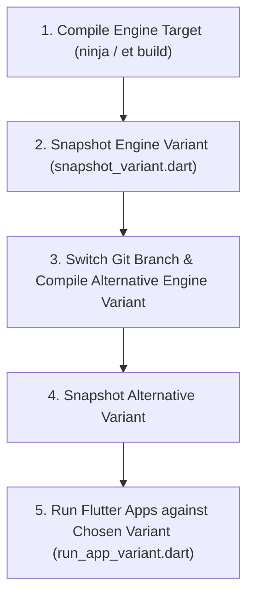

# Local Engine Variants Management Guide

Use this skill when you need to compile, snapshot, and run Flutter apps or tests
against multiple local Flutter engine build variants (e.g. patched vs. baseline,
release vs. debug, Vulkan vs. Metal) without suffering continuous recompilation.

---

## Workflow Overview



---

## Step 1: Incremental Engine Compilation

From `engine/src/flutter` or workspace root, compile the engine target:

```bash
# In engine/src/flutter:
ninja -C ../out/host_debug impeller_unittests display_list_unittests flutter_tester
# Or using the engine tool:
et build -c host_debug
```

---

## Step 2: Snapshot the Compiled Engine Variant

To preserve your compiled binaries before modifying code or switching branches,
snapshot the build using `snapshot_variant.dart`:

```bash
# Snapshot the current build to out/<active_build>_patched:
dart .agents/skills/personal-manage-local-engine-variants/scripts/snapshot_variant.dart patched

# List all available snapshots:
dart .agents/skills/personal-manage-local-engine-variants/scripts/snapshot_variant.dart --list
```

---

## Step 3: Compile Baseline (Unpatched) Engine

Switch branches or stash your working tree to compile the clean baseline engine:

```bash
cd engine/src/flutter
git stash

# Compile baseline:
ninja -C ../out/host_debug impeller_unittests display_list_unittests flutter_tester

# Snapshot the baseline build:
cd -
dart .agents/skills/personal-manage-local-engine-variants/scripts/snapshot_variant.dart baseline

# Restore your working branch:
cd engine/src/flutter
git stash pop
```

You now have both engine variants ready for instant switching:
* `baseline`
* `patched`

---

## Step 4: Execute Flutter Apps Against Local Engine Variants

Run target Flutter applications directly using `run_app_variant.dart`:

### Running on Patched Variant:
```bash
dart .agents/skills/personal-manage-local-engine-variants/scripts/run_app_variant.dart \
  patched \
  repro/main.dart \
  --dart-define=CAPTURE_PATH=/tmp/patched.png
```

### Running on Baseline Variant:
```bash
dart .agents/skills/personal-manage-local-engine-variants/scripts/run_app_variant.dart \
  baseline \
  repro/main.dart \
  --dart-define=CAPTURE_PATH=/tmp/baseline.png
```

---

## Step 5: Headless Screenshot Capture Harness Pattern

When diagnosing rendering issues, configure the target app's `main.dart` with a
headless screenshot capture hook triggered by a `--dart-define=CAPTURE_PATH`:

```dart
import 'dart:io';
import 'dart:typed_data';
import 'dart:ui' as ui;
import 'package:flutter/rendering.dart';

final GlobalKey boundaryKey = GlobalKey();

Future<void> captureAndSave(String path) async {
  // Allow animations to finish:
  await Future<void>.delayed(const Duration(milliseconds: 1500));
  final boundary = boundaryKey.currentContext!.findRenderObject()! as RenderRepaintBoundary;
  final ui.Image image = await boundary.toImage(pixelRatio: 2.0);
  final ByteData? byteData = await image.toByteData(format: ui.ImageByteFormat.png);
  if (byteData != null) {
    final file = File(path);
    await file.parent.create(recursive: true);
    await file.writeAsBytes(byteData.buffer.asUint8List());
  }
  exit(0);
}
```
