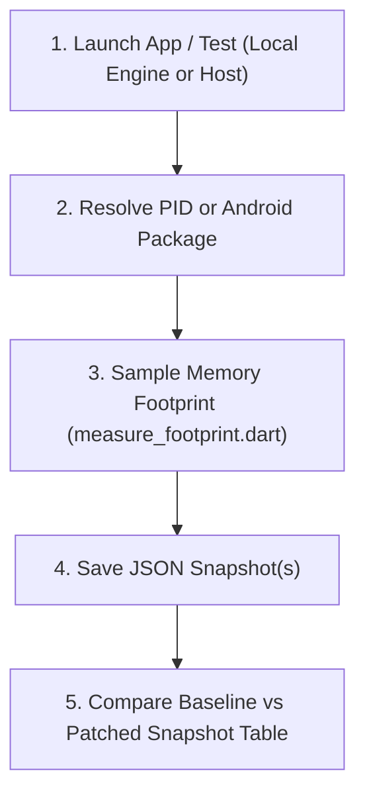

# Measure Process Footprint

Use this skill when you need to measure, sample, benchmark, or compare memory
usage and native footprint across Flutter applications, tests, or engine
variants.

---

## Workflow Overview



---

## Capabilities

* **macOS / iOS Simulator**: Invokes `/usr/bin/footprint` to capture accurate
  kernel-level physical footprint (`phys_footprint`), peak physical footprint,
  and categorized memory allocations (`VM_ALLOCATE`, `IOKit`, `IOSurface`,
  `Malloc`).
* **Android**: Uses `adb shell dumpsys meminfo` to capture total PSS, total RSS,
  Native Heap, Java Heap, Graphics, and stack allocations.
* **Continuous Sampling**: Gathers repeated samples at a specified interval to
  track heap expansion and transient leaks over time.
* **Snapshot Comparison**: Generates structured Markdown comparison tables with
  exact deltas and percentage changes between runs.

---

## CLI Usage

The helper script is located at:
`.agents/skills/personal-measure-process-footprint/scripts/measure_footprint.dart`

### 1. Single Snapshot by PID

```bash
dart .agents/skills/personal-measure-process-footprint/scripts/measure_footprint.dart \
  --pid 12345
```

### 2. Sample Over Time and Save JSON

Capture 10 samples every 1 second and save to a JSON artifact:

```bash
dart .agents/skills/personal-measure-process-footprint/scripts/measure_footprint.dart \
  --pid 12345 \
  --samples 10 \
  --interval 1.0 \
  --output /tmp/baseline_footprint.json
```

### 3. Android Target Profiling

```bash
dart .agents/skills/personal-measure-process-footprint/scripts/measure_footprint.dart \
  --android com.example.reproduce_app \
  --samples 5 \
  --output /tmp/android_patched.json
```

### 4. Compare Two Snapshots

```bash
dart .agents/skills/personal-measure-process-footprint/scripts/measure_footprint.dart \
  --compare /tmp/baseline_footprint.json /tmp/patched_footprint.json
```

---

## Automated Benchmark Pattern

When automating memory comparisons across engine variants in harness scripts:

```dart
import 'dart:io';

Future<void> runMemoryBenchmark(String variant) async {
  final process = await Process.start('dart', [
    '.agents/skills/personal-manage-local-engine-variants/scripts/run_app_variant.dart',
    variant,
    'lib/main.dart',
  ]);

  // Capture PID from output and record footprint snapshot:
  await Process.run('dart', [
    '.agents/skills/personal-measure-process-footprint/scripts/measure_footprint.dart',
    '--pid', pid.toString(),
    '--samples', '5',
    '--output', '/tmp/${variant}_footprint.json',
  ]);
}
```
